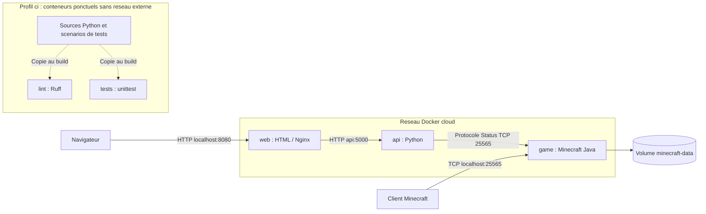

# TP Docker Cloud - Minecraft

Trois services applicatifs : **HTML avec Nginx**, **API Python**, **Minecraft
Java 1.21.11**. Deux conteneurs supplementaires, **lint** et **tests**, repondent
a la nouvelle consigne CI/CD et se lancent a la demande avec le profil `ci`.

Le site est un tableau de statut : il affiche l'adresse de connexion, la
disponibilite du serveur, sa version et le nombre de joueurs. Le bouton
Actualiser interroge l'API ; la page ne lance ni n'arrete Minecraft et ne
rafraichit pas automatiquement les donnees. Le jeu se pratique dans le client
Minecraft, pas dans le navigateur.

## Demarrer

Prerequis : Docker Desktop demarre en mode Linux, Python 3.10 ou plus sur
l'ordinateur, Internet. Les images sont construites pour linux/amd64.
Dans un terminal PowerShell ouvert dans le dossier tp :

```powershell
python prepare.py
Copy-Item .env.example .env
```

Ne recopier .env que la premiere fois, pour conserver ensuite ses reglages.
Lire [l'EULA Minecraft](https://www.minecraft.net/en-us/eula) et, uniquement
si tu acceptes, mettre `EULA=true` dans `.env`. Sinon le jeu refuse de demarrer.

```powershell
docker compose up --build -d --remove-orphans
docker compose ps
docker compose logs -f game
```

Attendre le message `Done` du serveur. Ouvrir **http://localhost:8080**.
Dans Minecraft **Java Edition 1.21.11**, choisir Multijoueur, Connexion directe,
puis **localhost:25565**. L'authentification est active : un compte valide est
necessaire. L'API et la page peuvent fonctionner meme si le jeu est arrete.

`--remove-orphans` retire les anciens conteneurs de ce projet, si presents,
sans supprimer les volumes. La preparation telecharge environ 60 Mo ;
les installations de Python, Java et Nginx demandent aussi Internet.

## Architecture



Le reseau `cloud` permet aux services de se trouver avec leur nom DNS.
Seuls le site et Minecraft publient des ports sur l'ordinateur. Nginx transmet
`/api/status` a Python. L'API renvoie l'etat, la version et le nombre de joueurs
fournis par Minecraft. Si le jeu ne repond pas, elle retourne `online=false`.
`lint` et `tests` ne se connectent pas aux services applicatifs : ils utilisent
le code copie dans leurs images. Le fichier `architecture.drawio` represente
les cinq conteneurs ; les fleches en pointilles indiquent les copies au build.

## Choix des images et dependances

Les cinq images partent de `scratch` et extraient un rootfs officiel Alpine
3.23.6. **Aucune image Docker Hub n'est utilisee**, meme pour la construction.
`prepare.py` telecharge le rootfs et le JAR officiel depuis Alpine et Mojang,
puis verifie les empreintes attendues : SHA256 pour Alpine, SHA1 fourni par
Mojang pour Minecraft. Les fichiers sont dans `.docker`, ignore par Git.

| Service | Paquets installes | Pourquoi | Port interne |
| --- | --- | --- | --- |
| web | nginx | Servir HTML et relayer les requetes API | 8080/TCP |
| api | python3 | API HTTP et interrogation de Minecraft | 5000/TCP |
| game | openjdk21-jre-headless, python3, eudev-libs | Java 21 execute Minecraft, Python configure et controle le serveur, eudev-libs fournit udev pour JNA | 25565/TCP |
| lint | ruff | Detecter les erreurs Python sans modifier le code | Aucun |
| tests | python3 | Executer unittest et les serveurs locaux de verification | Aucun port publie |

`apk add --no-cache` installe les paquets et leurs dependances sans conserver
le cache. Les runtimes apportent leurs bibliotheques systeme : compression,
SSL, musl et modules Python notamment. Le code Python n'utilise aucun paquet
pip. Java headless n'a pas besoin d'interface graphique.
Le /tmp du jeu autorise explicitement le chargement executable des bibliotheques
natives JNA/Netty ; sa taille reste bornee a 64 Mio, avec nosuid et nodev.
Les /tmp du web et de l'API restent noexec.
Les paquets Alpine peuvent evoluer : rootfs et JAR fixes ne garantissent pas
un build identique bit pour bit dans le temps.

## Operations sur le systeme et points d'entree

- `addgroup` et `adduser` creent le compte applicatif UID/GID 10001.
- `USER` lance les cinq services sans privileges root.
- `WORKDIR` definit les repertoires de travail ; `COPY` ajoute le code.
- `COPY --chown` attribue les fichiers au compte applicatif.
- Le jeu cree `/data` et en donne la propriete a cet utilisateur pour sauvegarder.
- Nginx ecrit ses logs sur stdout/stderr, son PID et ses fichiers temporaires
  dans `/tmp`. Le port 8080 permet son execution sans privileges root.
- `PYTHONUNBUFFERED` affiche immediatement les logs ; `PYTHONDONTWRITEBYTECODE`
  evite la creation de fichiers pyc.
- `apk upgrade --no-cache` applique les correctifs aux paquets deja presents
  dans le rootfs avant l'installation des dependances propres a chaque image.
- Pour les outils CI, `WORKDIR /workspace` regroupe les sources copiees au build.
  Aucun fichier `.env`, JAR Minecraft ou monde sauvegarde n'y est copie.

`ENTRYPOINT` utilise la forme exec : Nginx et l'API sont les processus principaux.
Nginx reste au premier plan avec `daemon off`. L'API traite SIGTERM et ferme
proprement son serveur HTTP. Pour Minecraft, `start.py` configure les fichiers
puis se remplace par Java avec `os.execvp` : Java recoit donc SIGTERM directement
et lance sa procedure d'arret et de sauvegarde. Compose lui laisse 60 secondes.
Nginx utilise SIGQUIT pour son arret progressif et gere aussi SIGTERM pour un
arret rapide ; l'API dispose de 10 secondes pour s'arreter.
Pour `lint`, l'ENTRYPOINT lance directement `ruff check` avec sa configuration ;
le CMD precise les dossiers controles. Pour `tests`, l'ENTRYPOINT lance
`python3 -m unittest` et le CMD demande la decouverte des scenarios. Aucun
shell intermediaire ne masque le code de sortie. Ces deux outils recoivent
directement SIGTERM et disposent de 10 secondes pour quitter. Ils ne stockent
pas de donnees persistantes et ne redemarrent pas automatiquement.

## Parametres et ressources

| Parametre | Utilisation |
| --- | --- |
| EULA | Acceptation personnelle obligatoire avant lancement du jeu |
| SERVER_NAME | Nom affiche sur le site et MOTD Minecraft |
| GAME_PORT | Port du serveur, publication et cible de l'API |
| GAME_BIND_ADDRESS | Adresse d'ecoute sur l'hote, 127.0.0.1 par defaut |
| PUBLIC_GAME_ADDRESS | Adresse affichee au joueur |
| WEB_PORT | Port du site sur l'ordinateur |
| MAX_PLAYERS | Nombre maximal de joueurs |
| JAVA_XMS / JAVA_XMX | Tas Java initial et maximal |
| WEB/API/GAME_CPUS | Plafonds CPU de chaque service |
| WEB/API/GAME_MEMORY | Plafonds memoire de chaque service |
| API_REPLICAS | Nombre d'instances de l'API (1 par defaut) |
| LINT_CPUS / LINT_MEMORY | Plafonds de ressources du conteneur Ruff |
| TESTS_CPUS / TESTS_MEMORY | Plafonds de ressources du conteneur unittest |

Ces valeurs figurent dans `.env.example` et sont transmises par Compose.
`PORT=5000` et `GAME_HOST=game` configurent aussi l'API dans Compose.
Si GAME_PORT change, adapter PUBLIC_GAME_ADDRESS et la connexion du client.

| Service | CPU max | Memoire max | Justification |
| --- | --- | --- | --- |
| web | 0.2 | 128 Mio | Page statique et petites requetes |
| api | 0.5 | 128 Mio | API legere, sans framework |
| game | 2 | 2 Gio | Petit serveur de TP avec tas Java de 1536 Mio |
| lint | 0.5 | 256 Mio | Analyse ponctuelle de plusieurs fichiers Python |
| tests | 0.5 | 128 Mio | Petite suite unittest, sans JVM ni monde de jeu |

Ce sont des plafonds, pas des reservations. `JAVA_XMX=1536M` reste inferieur
a la limite de 2 Gio pour laisser de la place aux allocations natives et
threads. Ajuster selon le monde et le nombre de joueurs avec `docker stats`.

### Scaling de l'API

Les plafonds RAM sont aussi declares dans `deploy.resources.limits` et
s'appliquent **par conteneur**. Trois API peuvent donc consommer au maximum
384 Mio et 1,5 coeur au total. Le web reste a 128 Mio et Minecraft a 2 Gio.

Pour lancer trois instances de l'API, definir `API_REPLICAS=3` dans `.env`,
puis executer :

```powershell
docker compose up -d api web
docker compose ps
```

Nginx retrouve les instances via le DNS Docker du service `api` (cache de
10 secondes) et repartit ses connexions entre les adresses disponibles.
Il s'agit de scaling manuel, sans ajustement automatique selon la charge.
Revenir a `API_REPLICAS=1` puis relancer la commande pour reduire le nombre.
Le web garde une instance car il publie un port fixe. Minecraft garde une
instance car plusieurs serveurs ne doivent pas ecrire dans le meme monde.

## Conteneurs CI/CD : lint et tests

Ces deux services remplissent les deux ajouts demandes par le nouveau sujet.
Le profil `ci` les separe du lancement habituel de l'application. Il n'est
pas necessaire de demarrer Minecraft ni d'accepter l'EULA pour les executer.
Ils n'ont pas de dependance `depends_on`, pas de volume applicatif et aucun
port publie. `network_mode: none` interdit l'acces reseau externe ; la boucle
locale reste disponible pour les serveurs de tests.

Depuis le dossier du projet, apres `python prepare.py` :

```powershell
docker compose --profile ci run --rm --build lint
# Verifier le code de sortie immediatement apres la commande.
$LASTEXITCODE
docker compose --profile ci run --rm --build tests
$LASTEXITCODE
```

`--build` actualise l'image avec les sources du depot ; `--rm` supprime le
conteneur ponctuel une fois termine. Un code **0** indique un succes ; un code
**non nul** signale un probleme. Ces commandes ne corrigent pas le code.
Le lancement est manuel : aucun pipeline distant n'est configure.

### Lint

Ruff est installe depuis les depots Alpine, sans image Docker Hub ni paquet
pip. `lint/ruff.toml` active `E9` et `F` : erreurs de syntaxe, noms inconnus,
imports et variables inutilises. Il analyse `api`, `game/start.py`, `prepare.py`
et `tests`. Il ne reformate pas le projet, ne verifie pas les CVE et n'analyse
pas HTML ou les fichiers Docker. `--no-cache` evite d'ecrire un cache dans
l'image en lecture seule. Le resultat attendu est `All checks passed!`.

### Tests

Python fournit `unittest`, sans dependance supplementaire. Les 12 tests couvrent :

- Les routes HTTP `/health`, `/api/status` et une route inconnue (404).
- L'etat en ligne, les donnees de joueurs, le cache et le cas d'un jeu absent
  ou renvoyant une reponse invalide.
- L'echange binaire Status Minecraft, les bornes des VarInt, les donnees
  tronquees, les reponses trop grandes et les valeurs de joueurs invalides.

Les tests HTTP lancent une API locale temporaire. Le protocole Minecraft est
verifie avec un serveur local controle : aucun vrai monde n'est modifie et
aucun compte joueur n'est utilise. Le resultat attendu est `Ran 12 tests`,
puis `OK`. Ces scenarios ne remplacent pas une connexion dans le vrai jeu.
La verification locale du 29 octobre 2026 confirme les 12 tests et Ruff.
Docker Desktop etant arrete lors de cet audit, cette verification ne confirme
pas une nouvelle execution de ces commandes dans leurs conteneurs.

## Demarrage et stockage

Le jeu et le site attendent que l'API soit saine. Cela permet de consulter
l'etat meme pendant le chargement de Minecraft. L'API utilise `/health`,
Nginx aussi. Le healthcheck du jeu interroge le protocole Status Minecraft,
avec 120 secondes de delai initial pour generer le monde. `depends_on` regle
le demarrage, pas une surveillance continue des dependances.

Le volume `minecraft-data` conserve monde, configuration, journaux et listes
de joueurs. Ne pas modifier un monde pendant que le serveur tourne.

```powershell
Invoke-RestMethod http://localhost:8080/api/status
docker compose logs
docker stats --no-stream
docker compose stop game
# Le site doit maintenant afficher un serveur arrete.
docker compose start game
# Attendre que le jeu soit sain, puis verifier le monde dans Minecraft.
docker compose down
```

`down` conserve le volume ; **`down -v` le supprime**. Pour verifier la
persistance, modifier le monde dans Minecraft, arreter proprement, recreer
le conteneur avec `docker compose up -d --force-recreate game`, puis rejoindre.

## Docker et machines virtuelles

Les conteneurs partagent le noyau de leur environnement d'execution ; une VM
possede son propre noyau et systeme complet. Docker facilite la reproduction
des services et Compose centralise ressources, reseau et dependances.
Sous Windows, Docker Desktop fournit un environnement Linux pour ces images.

## Rendu Git

Depot configure : https://github.com/edgouille/dev-docker.
Fournir ce lien pour le rendu et pousser les derniers changements avant
la date limite : le correcteur examine le dernier commit avant cette date. `.docker` et `.env`
ne doivent pas etre publies ; les scripts et `.env.example` permettent de
reconstruire. Le README contient les explications et le schema demandes.
Des captures du site, des conteneurs et d'une connexion Minecraft peuvent
completer le rendu ; elles ne sont pas exigees par le PDF fourni.

## Mesures de ressources complementaires

Le bareme demande d'expliquer les limites CPU et RAM ; le PDF ne demande
pas de benchmarks. Les mesures suivantes peuvent completer leur justification.
Utiliser `docker stats` au repos puis avec un joueur connecte et noter les
valeurs observees. Une mesure anterieurement rapportee de 20 secondes sans joueur a releve environ
631 Mio au maximum observe pour Minecraft, sur 2 Gio disponibles.
Les mesures avec un joueur actif restent a effectuer.

## Fonctionnement et securite

Les conteneurs fonctionnent sans privileges supplementaires, avec racine
en lecture seule, /tmp borne et limite de processus. L'API limite ses
connexions ; Nginx limite les requetes de statut et masque les versions.
Minecraft et le site sont accessibles uniquement depuis l'ordinateur par
defaut. Une exposition reseau du jeu exige GAME_BIND_ADDRESS explicite.

Les validations suivantes sont rapportees dans la documentation existante ;
elles n'ont pas ete reproduites lors de l'audit du 29 octobre 2026.
Le protocole et le scaling ont d'abord ete verifies avec une simulation.
Apres acceptation personnelle de l'EULA, le vrai serveur a genere son monde,
repondu a l'API et demande l'authentification lors d'une tentative de login.
La sauvegarde sur SIGTERM et la conservation du monde apres recreation sont
verifiees, avec lecture des metadonnees du monde. La connexion d'un vrai joueur
a ensuite ete confirmee par l'utilisateur.
Les modifications de securite ne remplacent pas la mise a jour de Docker
Desktop ni celle du serveur Minecraft et de ses bibliotheques embarquees.

Sources : [Alpine officiel](https://dl-cdn.alpinelinux.org/alpine/v3.23/releases/x86_64/),
[serveur Minecraft officiel](https://www.minecraft.net/en-us/download/server).

## Verification du sujet et du bareme

Voir [AUDIT.md](AUDIT.md) pour la correspondance critere par critere, les
controles executes et les verifications Docker restant a reproduire.
